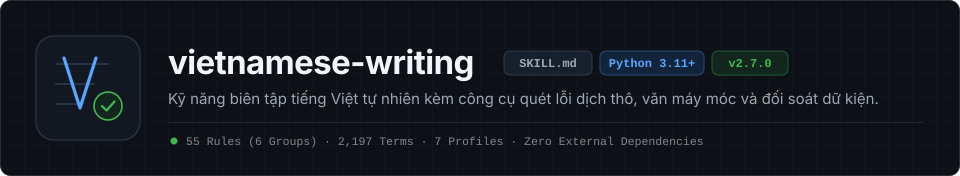

<a id="top"></a>

<div align="center">

<picture>
  <source media="(prefers-color-scheme: dark)" srcset="./assets/banner-dark.svg">
  <source media="(prefers-color-scheme: light)" srcset="./assets/banner-light.svg">
  
</picture>

<br>

[](https://github.com/ducle2502/vietnamese-writing/actions/workflows/ci.yml)    [](./LICENSE)

[Ví dụ](#ví-dụ-trước-và-sau) · [Tổng quan](#tổng-quan) · [Cài đặt nhanh](#cài-đặt-nhanh) · [6 nhóm quy tắc](#6-nhóm-quy-tắc-và-7-ngữ-cảnh-văn-bản) · [Dòng lệnh](#chạy-từ-dòng-lệnh) · [Cấu trúc thư mục](#cấu-trúc-thư-mục) · [Giới hạn phạm vi](#giới-hạn-phạm-vi)

</div>

**vietnamese-writing** là gói kỹ năng (`SKILL.md`) kèm công cụ dòng lệnh [scripts/vi_scanner.py](scripts/vi_scanner.py). Bộ công cụ giúp Agent viết, biên tập tiếng Việt tự nhiên, sát người đọc và giữ nguyên số liệu gốc. Mọi lệnh chạy trực tiếp trên `Python 3.11+` bằng thư viện chuẩn, không cần cài thêm gói ngoài.

## Ví dụ trước và sau

Đoạn báo cáo nháp bên dưới mắc lỗi dịch sát từ tiếng Anh, lộ mã hồ sơ nội bộ và khẳng định vượt bằng chứng:

```text
Tóm tắt điều hành: Quy định này đã lỗi thời so với pháp luật. Căn cứ WP-04,
báo cáo tuân thủ kỷ luật bằng chứng và đã được phê duyệt bởi Ban kiểm tra
với tỷ lệ đối chiếu 92,5%.
```

Khi chạy `python -B scripts/vi_scanner.py scan nhap.md --profile audit_report`, công cụ gắn cờ năm vị trí cần sửa:

```text
L1:1   [VIS-TRANS-005]  Tóm tắt điều hành       -> Thay bằng Tóm tắt hoặc Tóm tắt báo cáo
L1:34  [VIS-TONE-003]   đã lỗi thời so với...   -> Nêu rõ văn bản hiệu lực thay thế
L1:72  [VIS-STRUCT-004] WP-04                   -> Gỡ mã theo dõi nội bộ khỏi bản gửi ngoài
L2:19  [VIS-TRANS-015]  kỷ luật bằng chứng      -> Đổi sang nguyên tắc chứng cứ
L2:44  [VIS-TRANS-001]  được phê duyệt bởi      -> Đưa chủ thể lên đầu câu chủ động
```

Bản viết lại dưới đây đạt `0` lỗi trên máy quét và giữ nguyên con số `92,5%` khi đối chiếu bằng lệnh `verify`:

> Tóm tắt báo cáo: Quy định chưa cập nhật theo thông tư hiệu lực từ ngày 01/01/2026. Ban kiểm tra đã phê duyệt báo cáo trên cơ sở biên bản nghiệm thu, đạt tỷ lệ đối chiếu 92,5% trong kỳ.

## Tổng quan

Công cụ không cấm từ Hán - Việt một cách máy móc. Thay vào đó, `55` quy tắc (`16` mức `error`, `39` mức `warning`, không còn `info`) rà câu rào đón, bị động dịch từng chữ, danh từ hóa và dấu gạch ngang dài (`—`). Mọi câu quá `35` từ (`45` từ với văn bản pháp lý, tính cả ô bảng) cùng `15` lỗi hình thức rõ ràng đều báo `error` ngay lập tức.

Mặc định lệnh `scan` chạy ở chế độ `all` để giữ chuẩn nền tối thiểu trên mọi loại văn bản. Khi người dùng chỉ định `--profile`, công cụ lọc bớt các ngoại lệ hợp lệ theo thể loại như câu bị động theo quy ước trong hợp đồng hay bài báo khoa học. Khi quét, vùng mã nguồn, đường dẫn URL và trích dẫn trong ngoặc kép tự động được bỏ qua mà không lệch số dòng, số cột.

Đạt `0` lỗi trên máy quét mới chỉ hoàn thành Bước 1 về tầng hình thức. Với tài liệu từ `300` từ trở lên hoặc văn bản `audit_report`, `legal` gửi ra ngoài, Agent phải chạy thêm Bước 2. Ở bước này, Agent mở `2` đến `3` `subagent` đọc lạnh theo vai người đọc để chấm trên `4` trục (tự nhiên ngôn ngữ, dễ hiểu, nhất quán, không thể hiểu sai).

| Lệnh chính | Công dụng thực tế | Đầu vào hỗ trợ |
|---|---|---|
| `scan` | Rà `55` quy tắc và `2.230` mục từ vựng, giữ chuẩn nền chung | Markdown thô, tệp UTF-8 và `.docx` |
| `profile` | Đo `18` chỉ số nhịp câu, `14` chỉ số lập luận DHDNA và xếp loại giọng văn | Markdown thô, tệp UTF-8 và `.docx` |
| `verify` | Đối chiếu `6` nhóm dữ kiện gốc trước và sau khi sửa (số liệu, phủ định, điều kiện...) | Cặp tệp gốc và tệp đã sửa |
| `check-maintenance` | Nhắc lịch rà soát định kỳ danh sách từ tiếng Anh quen dùng (`63` phổ thông, `115` công sở) | Tự đọc từ [data/vocab.csv](data/vocab.csv) |

Với tài liệu không phải Markdown, Agent chuyển trước sang `TEN_GOC.raw.md` bằng `markitdown`, `liteparse`, `docling` hoặc `pandoc`. Phương án đọc ảnh `vision` chỉ dùng khi công cụ trực tiếp thất bại và phải gắn cờ `needs_review=true` vào tệp metadata. Riêng tệp Word `.docx`, `scan` và `profile` đọc trực tiếp nội dung qua thư viện chuẩn và hỗ trợ bỏ cột trích lục ngoài (`--ignore-table-cols`). Công cụ cũng phát hiện lệch tiêu đề kỳ trước (`template_title_mismatch`) và cảnh báo trôi mẫu số giữa các trang.

## Cài đặt nhanh

Cài đặt trực tiếp vào Claude Code, Cursor, Codex, Antigravity hoặc chạy độc lập trong vòng 1 phút:

```bash
# Cài qua skills.sh CLI (hỗ trợ Claude Code, Cursor, Codex, Antigravity)
npx skills add ducle2502/vietnamese-writing

# Cài qua Skills Manager CLI
skills-manager-cli skills install https://github.com/ducle2502/vietnamese-writing.git

# Cài qua pi
pi install git:github.com/ducle2502/vietnamese-writing
```

Tải mã nguồn và chạy kiểm tra trên `Python 3.11+`:

```bash
git clone https://github.com/ducle2502/vietnamese-writing.git
cd vietnamese-writing
python -B scripts/vi_scanner.py selftest
python -B scripts/vi_scanner.py scan SKILL.md
```

## 6 nhóm quy tắc và 7 ngữ cảnh văn bản

Bảng tra cứu đầy đủ từng quy tắc kèm ví dụ câu lỗi và cách sửa nằm tại [references/rule-catalog.md](references/rule-catalog.md).

| Nhóm mã | Nhóm lỗi câu chữ | Số quy tắc | Dấu hiệu thường gặp |
|---|---|---|---|
| `VIS-AI-001..007` | Câu chữ khuôn mẫu của AI | `7` | Rào đón kiểu chatbot, mở bài *"Trong bối cảnh..."*, bắt tưởng tượng tình huống giả, câu gom mọi nhóm người đọc và chỗ trống chưa điền. |
| `VIS-RHET-001..010` | Phóng đại và dàn ý lộ liễu | `10` | Khung *"không chỉ... mà còn"*, *"hơn cả X, đây là Y"*, kịch tính giả (*"tưởng chừng... nhưng"*), tự khen, phản biện khống, ẩn dụ sáo và dẫn nguồn chung chung. |
| `VIS-FMT-001..008` | Trình bày và nhịp đoạn máy móc | `8` | Danh sách `**Nhãn:**` đóng khuôn, từ nối đầu câu dày đặc, lạm dụng gạch ngang dài (`—`), xếp ba tính từ khen ngợi, chia đoạn đều tăm tắp hoặc chuỗi câu cụt. |
| `VIS-TRANS-001..015` | Dịch sát từng chữ | `15` | Bị động *"được... bởi..."*, danh từ hóa nặng nề, chuỗi sở hữu *"của... của... của"*, danh từ ghép kiểu *"kỷ luật/hàng rào/cổng/cảnh báo + lĩnh vực"* và lặp *"mang tính"*. |
| `VIS-CLICHE-001..005` | Sáo ngữ hành chính và quảng cáo | `5` | Động từ rỗng (*"tiến hành việc kiểm tra"*), khẩu hiệu thiếu đầu ra, ghép thừa từ trùng nghĩa, mời gọi SEO và chồng nhiều lớp từ rào đón. |
| `VIS-LEX` · `VIS-TONE` · `VIS-STRUCT` · `VIS-LEN` | Từ vựng, giọng văn, độ dài câu và bằng chứng | `10` | Chặn câu quá `35` từ (`45` từ với văn bản pháp lý, cả trong ô bảng), sai nghĩa Hán - Việt (`thực chứng`) và sai chính tả công sở (`sồn sã`, `chỉnh chu`, `cập nhập`). Đồng thời bắt dịch ngược (`thư điện tử`), giọng giật gân (`phát lộ`, `sập API`, `vỏn vẹn`), khẳng định quá bằng chứng, lộ mã nội bộ và lỗi số liệu. |

## Chạy từ dòng lệnh

Chuyển tệp nguồn sang `TEN_GOC.raw.md` trước khi quét, riêng `.docx` truyền trực tiếp vào lệnh `scan` hoặc `profile`:

```bash
# 1. Quét chuẩn nền chung trên toàn bộ 7 nhóm văn bản (mặc định)
python -B scripts/vi_scanner.py scan TEN_GOC.raw.md

# 2. Quét báo cáo kiểm toán và bỏ qua cột trích lục của bên thứ ba
python -B scripts/vi_scanner.py scan TEN_GOC.raw.md --profile audit_report --ignore-table-cols 2,3

# 3. Đo 18 chỉ số nhịp câu và 14 chỉ số lập luận DHDNA
python -B scripts/vi_scanner.py profile TEN_GOC.raw.md --ignore-table-cols 2,3 --json

# 4. Đối chiếu số liệu, phủ định, điều kiện và trích dẫn trước - sau khi sửa
python -B scripts/vi_scanner.py verify TEN_GOC.raw.md BAN_SUA.md

# 5. Kiểm tra hạn rà soát định kỳ danh sách từ tiếng Anh quen dùng
python -B scripts/vi_scanner.py check-maintenance

# 6. Chạy trọn bộ kiểm thử tự động và kiểm tra giới hạn mã nguồn
python -B -m pytest -v
```

## Cấu trúc thư mục

| Đường dẫn | Vai trò trong gói kỹ năng |
|---|---|
| [SKILL.md](SKILL.md) | Hướng dẫn thao tác chính cho AI Agent. |
| [AGENTS.md](AGENTS.md) | Quy tắc rút gọn khi làm việc trực tiếp trong repo. |
| [data/vocab.csv](data/vocab.csv) · [data/grammar.csv](data/grammar.csv) | Bảng `2.230` mục từ vựng và `55` quy tắc ngữ pháp chuẩn `UTF-8 BOM`, mở trực tiếp bằng Excel. |
| [scripts/vi_scanner.py](scripts/vi_scanner.py) | Công cụ quét văn bản, đọc trực tiếp `.docx`, đo giọng văn DHDNA và đối soát dữ kiện gốc. |
| [references/rule-catalog.md](references/rule-catalog.md) | Bảng tra cứu `55` quy tắc kèm nguồn, ngoại lệ và cách viết lại. |
| [references/voice-and-argument-patterns.md](references/voice-and-argument-patterns.md) | `4` kiểu giọng chính, `12` chiều DHDNA, quy trình 2 bước đọc lạnh `subagent`, khung `5C` và `10` quy tắc viết ghi chú bảng kiểm. |
| [references/loanwords-and-exceptions.md](references/loanwords-and-exceptions.md) | Quy trình cập nhật từ mượn tiếng Anh và ma trận ngoại lệ của `7` ngữ cảnh văn bản. |
| [references/pattern-bank.md](references/pattern-bank.md) | Ngân hàng `50` cấu trúc, `500` khuôn câu AI hoặc dịch thô và `12` bộ lọc regex. |
| [references/sentence-craft-and-syntax.md](references/sentence-craft-and-syntax.md) | Quy tắc cấu trúc `C–V` nội tại, biến đổi câu, `5` phép liên kết, chọn từ 2 trục và bộ từ rác AI mới. |
| [evals/evals.json](evals/evals.json) | Bộ kịch bản kiểm tra hành vi biên tập thực tế của Agent. |
| [tests/](tests/) | Bộ kiểm thử `pytest` gồm `100+` mẫu đối chứng, hồi quy, giới hạn mã nguồn và tự kiểm tài liệu. |
| [pyproject.toml](pyproject.toml) | Cấu hình `mypy`, `ruff` và giới hạn độ dài mã nguồn `[tool.code_limits]`. |
| [CONTRIBUTING.md](CONTRIBUTING.md) · [CHANGELOG.md](CHANGELOG.md) | Hướng dẫn đóng góp quy tắc mới và lịch sử phiên bản. |

## Giới hạn phạm vi

- Kết quả từ [scripts/vi_scanner.py](scripts/vi_scanner.py) chỉ đánh dấu chỗ câu chữ gượng gạo, sáo rỗng hoặc dịch sát cần đọc lại. Không dùng công cụ để kết luận văn bản do con người hay AI viết.
- Mục tiêu là tiếng Việt gọn rõ, đúng người đọc và nguyên vẹn dữ kiện gốc. Công cụ không tự chèn lỗi chính tả hay biến dạng văn phong để lách trình dò tự động.
- Khi người dùng dán hợp đồng, báo cáo hoặc tài liệu chỉ để hỏi nội dung bên trong, Agent giữ nguyên văn bản đó và trả lời trực tiếp câu hỏi.

## Giấy phép

Phát hành theo giấy phép [MIT](LICENSE).
