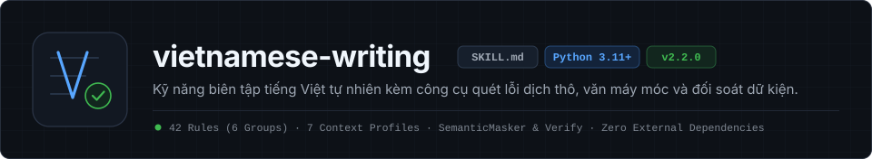

<a id="top"></a>

<div align="center">

<picture>
  <source media="(prefers-color-scheme: dark)" srcset="./assets/banner-dark.svg">
  <source media="(prefers-color-scheme: light)" srcset="./assets/banner-light.svg">
  
</picture>

<br>

[](https://github.com/ducle2502/vietnamese-writing/actions/workflows/ci.yml)   [](./LICENSE)

[Tổng quan](#tổng-quan) · [Cài đặt nhanh](#cài-đặt-nhanh) · [6 nhóm quy tắc](#6-nhóm-quy-tắc-và-7-ngữ-cảnh-văn-bản) · [Dòng lệnh](#cách-sử-dụng-dòng-lệnh) · [Cấu trúc thư mục](#cấu-trúc-thư-mục) · [Giới hạn phạm vi](#giới-hạn-phạm-vi)

</div>

**vietnamese-writing** là gói kỹ năng chuẩn (`SKILL.md`) đi kèm công cụ dòng lệnh [scripts/vi_scanner.py](scripts/vi_scanner.py) giúp AI Agent viết, biên tập và tự kiểm tra tiếng Việt tự nhiên, rõ chủ thể mà vẫn giữ nguyên vẹn dữ kiện gốc. Công cụ chạy trực tiếp trên thư viện chuẩn `Python 3.11+`, không cần cài thêm gói phụ thuộc ngoài và đang được bảo trì định kỳ.

## Tổng quan

- **Bắt đúng cấu trúc dịch thô, câu dài vòng vo và khuôn mẫu máy móc.** Thay vì cấm từ Hán - Việt cơ học, 31 quy tắc trong [scripts/vi_scanner.py](scripts/vi_scanner.py) chỉ ra câu rào đón chatbot và cấu trúc bị động dịch từng chữ (*"được thực hiện bởi"*). Quy tắc `VIS-LEN-001` phạt nặng câu văn xuôi quá dài hoặc mở câu vòng vo, đi kèm các quy tắc bắt danh từ hóa, nhãn in đậm lặp khuôn và từ Hán - Việt dùng sai nghĩa.
- **Quét đủ 100% tín hiệu kèm miễn trừ theo 7 ngữ cảnh.** Lệnh `scan` mặc định chạy ở chế độ `all` và xuất toàn bộ tín hiệu trên 7 nhóm văn bản (`general`, `audit_report`, `academic`, `legal`, `marketing`, `social_media`, `translation`). Mỗi kết quả đều kèm trường `applicable_profiles` và `exempt_profiles`. Nhờ đó, câu bị động hợp lệ trong hợp đồng pháp lý hoặc trích dẫn học thuật không bị ép sửa sai ngữ cảnh.
- **Che chắn vùng mã lệnh và đối soát bảo toàn dữ kiện.** Lớp `SemanticMasker` tự động bỏ qua khối code, mã nội dòng, đường dẫn URL và lời trích dẫn trong ngoặc kép mà không làm lệch số dòng hay số cột. Sau khi biên tập, lệnh `verify` đối chiếu bản gốc và bản sửa. Bước này chặn lỗi làm rơi con số, từ phủ định, từ chỉ điều kiện hoặc mức độ chắc chắn.
- **Tách bạch từ mượn đã quen dùng với từ chêm vô lối.** Bộ lọc âm vị nhận diện từ tiếng Anh chêm lẫn trong câu. Tuy nhiên, bộ lọc tự động loại trừ danh sách từ đã quen dùng hàng ngày (`email`, `web`, `file`, `video`, `team`, `deadline`, `server`, `kpi`). Công cụ cũng nhắc lịch rà soát định kỳ qua lệnh `check-maintenance`.
- **Đọc trực tiếp tệp `.docx` và đo tất định hồ sơ giọng văn (`DHDNA` & `Stylometry`).** Lệnh `scan` và `profile` đọc thẳng tệp Word `.docx` bằng thư viện chuẩn. Công cụ hỗ trợ `--ignore-table-cols` để loại trừ các cột bảng trích lục văn bản của bên thứ ba. Ngoài ra, máy quét kiểm tra lỗi sót tiêu đề kỳ cũ trong thuộc tính tệp (`template_title_mismatch`), phát hiện xung đột mẫu số và phân loại tất định kiểu giọng văn theo 4 mẫu chuẩn tại [references/voice-and-argument-patterns.md](references/voice-and-argument-patterns.md).

## Cài đặt nhanh

Bạn có thể cài trực tiếp kỹ năng này vào Claude Code, Cursor, Codex, Antigravity hoặc chạy độc lập từ dòng lệnh trong vòng 1 phút:

```bash
# Cài qua skills.sh CLI (hỗ trợ Claude Code, Cursor, Codex, Antigravity)
npx skills add ducle2502/vietnamese-writing

# Cài qua Skills Manager CLI
skills-manager-cli skills install https://github.com/ducle2502/vietnamese-writing.git

# Cài qua pi
pi install git:github.com/ducle2502/vietnamese-writing
```

Nếu muốn tải trực tiếp mã nguồn và chạy thử ngay công cụ quét bằng `Python 3.11+`:

```bash
git clone https://github.com/ducle2502/vietnamese-writing.git
cd vietnamese-writing
python -B scripts/vi_scanner.py selftest
python -B scripts/vi_scanner.py scan SKILL.md
```

## 6 nhóm quy tắc và 7 ngữ cảnh văn bản

Chi tiết toàn bộ 31 mã quy tắc cùng ví dụ câu lỗi và câu viết lại nằm tại [references/rule-catalog.md](references/rule-catalog.md):

| Nhóm mã | Tên nhóm quy tắc | Số quy tắc | Các lỗi trọng tâm được chỉ ra |
|---|---|---|---|
| `VIS-AI-001..005` | Tín hiệu sinh văn của AI | `5` | Câu rào đón/kết thúc kiểu chatbot, mở bài vĩ mô (*"Trong bối cảnh..."*), cặp sóng đôi giả (*"không chỉ... mà còn"*), chuỗi danh sách đóng khuôn `**Nhãn:**`, lạm dụng gạch ngang dài (`—`) và chấm phẩy (`;`). |
| `VIS-RHET-001..005` | Tu từ phóng đại và dàn ý lộ liễu | `5` | Cụm tự khen tầm vóc (*"đóng vai trò then chốt"*), sáo ngữ kết bài (*"mở ra kỷ nguyên mới"*), nối câu bằng *"Từ đó,"*, chuyển đoạn lộ khung dàn bài, cụm rào đón chồng chéo. |
| `VIS-FMT-001..005` | Định dạng và nhịp đoạn máy móc | `5` | Chèn biểu tượng trang trí đầu dòng, chia đều độ dài đoạn văn như máy in, viết hoa kiểu tiêu đề tiếng Anh, lạm dụng ngoặc kép hoặc in nghiêng quanh từ thông thường. |
| `VIS-TRANS-001..005` | Cấu trúc dịch sát từ tiếng Anh | `5` | Câu bị động dịch từ *by* (*"được phê duyệt bởi"*), danh từ hóa (*"sự sụt giảm của"*), mở câu bằng *"Thông qua việc..."*, chủ ngữ giả (*"Nó là cần thiết"*), mật độ từ nối sách vở dày đặc. |
| `VIS-CLICHE-001..005` | Sáo ngữ hành chính và quảng cáo | `5` | Nhét động từ rỗng (*"tiến hành việc kiểm tra"*), tính từ phóng đại (*"toàn diện"*, *"chuyên sâu"*), khẩu hiệu thiếu đầu ra, cụm từ trùng nghĩa, câu khách kiểu quảng cáo. |
| `VIS-LEX` · `VIS-TONE` · `VIS-STRUCT` · `VIS-LEN` | Từ vựng, giọng văn, độ dài câu và kỷ luật bằng chứng | `6` | Phạt nặng câu dài quá `45` từ (`55` từ với văn bản pháp lý), câu nối đuôi nhiều dấu phẩy và dẫn dắt vòng vo (`VIS-LEN-001`), dùng sai từ Hán - Việt (`thực chứng`), dịch ngược từ quen dùng (`thư điện tử`), giọng sồn sã hoặc kịch tính hóa (`sập toàn tuyến`), gộp mục còn lỗi vào tỷ lệ hoàn thành và lệch tổng bảng số liệu. |

## Cách sử dụng dòng lệnh

```bash
# 1. Quét mặc định (chế độ 'all' xuất đủ 100% tín hiệu của cả 7 nhóm văn bản)
python -B scripts/vi_scanner.py scan BAI_VIET.md

# 2. Quét trực tiếp tệp Word .docx và bỏ qua cột bảng trích lục bên thứ ba
python -B scripts/vi_scanner.py scan BAO_CAO.docx --profile audit_report --ignore-table-cols 2,3

# 3. Đo tất định 18 chỉ số nhịp câu (stylometry) và 12 chỉ số kỷ luật lập luận DHDNA
python -B scripts/vi_scanner.py profile BAO_CAO.docx --ignore-table-cols 2,3 --json

# 4. Đối soát bảo toàn số liệu, phủ định, điều kiện và trích dẫn trước - sau khi sửa
python -B scripts/vi_scanner.py verify BAN_GOC.md BAN_SAU_SUA.md

# 5. Kiểm tra hạn rà soát định kỳ danh sách từ tiếng Anh quen dùng
python -B scripts/vi_scanner.py check-maintenance

# 6. Chạy bộ kiểm thử tự động (100+ mẫu kiểm thử độc lập và kiểm tra cấu trúc Skill)
python -B -m unittest discover -s tests -v
```

## Cấu trúc thư mục

| Đường dẫn | Vai trò |
|---|---|
| [SKILL.md](SKILL.md) | Hướng dẫn chính cho AI Agent (kèm phần khai báo đầu tệp chuẩn `YAML frontmatter`). |
| [AGENTS.md](AGENTS.md) | Quy tắc rút gọn khi mở trực tiếp thư mục dự án. |
| [data/vocab.csv](data/vocab.csv) · [data/grammar.csv](data/grammar.csv) | Bảng từ vựng và 31 quy tắc ngữ pháp chuẩn `UTF-8 BOM` để thêm, sửa, tắt hoặc xóa trực tiếp bằng Excel. |
| [scripts/vi_scanner.py](scripts/vi_scanner.py) | Công cụ dòng lệnh quét văn bản, đo hồ sơ giọng văn DHDNA, đọc `.docx` và đối soát dữ kiện. |
| [scripts/check_code_limits.py](scripts/check_code_limits.py) | Trình kiểm tra giới hạn độ dài tệp, hàm, lớp và cấu trúc dữ liệu theo `[tool.code_limits]`. |
| [references/rule-catalog.md](references/rule-catalog.md) | Bảng tra cứu chi tiết 31 quy tắc kèm ví dụ câu lỗi và câu sửa. |
| [references/voice-and-argument-patterns.md](references/voice-and-argument-patterns.md) | Bốn kiểu giọng văn chức năng, 6 kỷ luật dẫn số liệu/bằng chứng và bảng chuyển ngữ quản trị. |
| [references/loanwords-and-exceptions.md](references/loanwords-and-exceptions.md) | Quy trình cập nhật danh sách từ tiếng Anh quen dùng và ngoại lệ của 7 nhóm văn bản. |
| [evals/evals.json](evals/evals.json) | Bộ kịch bản kiểm thử hành vi biên tập thực tế cho Agent. |
| [tests/test_vi_scanner.py](tests/test_vi_scanner.py) | Bộ kiểm thử đơn vị (100+ mẫu đối chứng, kiểm tra hiệu năng chống treo máy và kiểm tra gói kỹ năng). |
| [pyproject.toml](pyproject.toml) | Cấu hình kiểm tra kiểu tĩnh `mypy`, độ phức tạp thuật toán với `ruff` và giới hạn kích thước mã `[tool.code_limits]`. |
| [CONTRIBUTING.md](CONTRIBUTING.md) · [CHANGELOG.md](CHANGELOG.md) | Hướng dẫn đóng góp quy tắc mới và lịch sử phiên bản. |

## Giới hạn phạm vi

- Mọi tín hiệu từ [scripts/vi_scanner.py](scripts/vi_scanner.py) chỉ chỉ ra các vị trí câu chữ gượng gạo, sáo rỗng hoặc dịch sát cần đọc lại, tuyệt đối không dùng để kết luận văn bản do con người hay AI viết.
- Kỹ năng này hướng tới câu tiếng Việt rõ nghĩa, đúng ngữ cảnh người đọc và giữ nguyên dữ kiện gốc, không thêm lỗi chính tả hay phương ngữ giả tạo để lách công cụ dò tự động.
- Nếu người dùng chỉ dán hợp đồng, báo cáo hoặc tài liệu để hỏi nội dung bên trong, Agent giữ nguyên văn bản gốc và trả lời thẳng vào câu hỏi.

## Giấy phép

Phát hành theo giấy phép [MIT](LICENSE).
